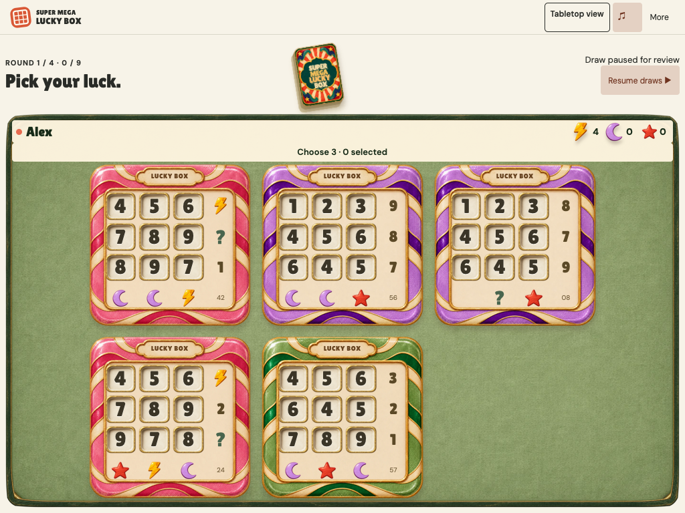
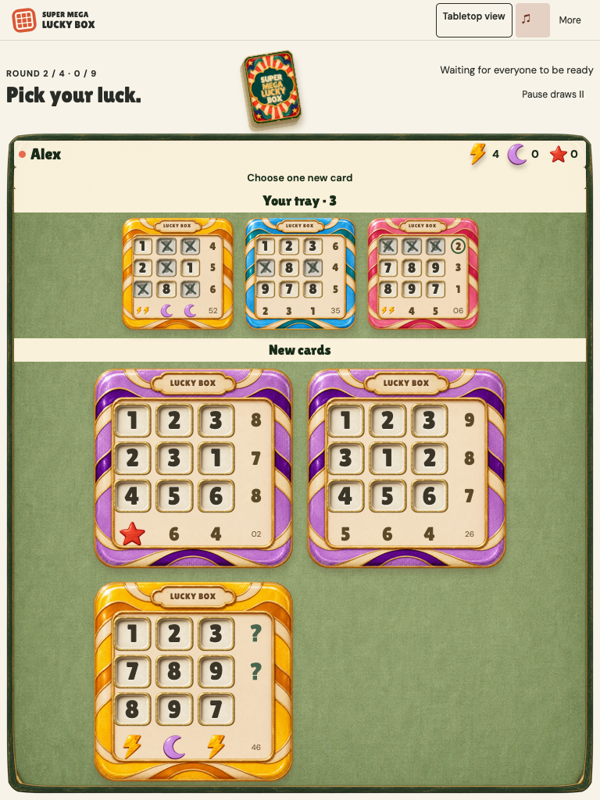

# iPad card layout review

Selection fits the complete offer into its measured surface: all five opening cards, or all three later offers. Opening offers use three columns in landscape and two in portrait. The existing tray remains visible as a compact, non-marking overview during later selection; touching a tray card opens the shared inspector. Selection does not use pages.

Tablets and medium-width laptop windows use a 104px status strip instead of the 200px side rail. Ordinary play retains 260px minimum cards for number marking, reserves the 44px contextual action dock, and caps unnecessarily large cards at 320px. Extra play cards may still use explicit pages. The layout responds to the actual card surface and the visual viewport, including Safari browser-bar height changes; pinch zoom does not shrink the game surface.

Ad hoc review used the production UI, Playwright 1.61.1 WebKit, and isolated Auth/Firestore emulators (`demo-supermega`, `ipad-review` scope). The later-round fixture was generated by replaying valid engine decisions, not by replacing the card renderer or supplying an alternate UI. No production data was used. This is review evidence, not screenshot baseline verification or an expanded gameplay e2e suite.

| Viewport | Opening offers | Card size | Document scroll |
| --- | --- | --- | --- |
| 768 × 1024 | All 5, two columns | 249px | None |
| 1024 × 768 | All 5, three columns | 250px | None |
| 1024 × 650 | All 5, three columns | 191px | None |
| 834 × 1100 | All 5, two columns | 274px | None |
| 1194 × 734 | All 5, three columns | 233px | None |
| 390 × 844 | All 5, two columns | 177px | None |
| 1180 × 820 | All 5, three columns | 276px | None |

All offer bounds were inside the viewport. Selecting two cards, rotating, and selecting the third preserved the selected identities and committed normally. Play was reviewed at 768×1024, 1024×768, and 1024×650; all three cards fitted and number targets measured at least 44px high. Later selection showed all three offers and all existing cards at those iPad sizes and 390×844. Touching an existing tray card opened the production inspector. Layout unit tests also cover six-card overview capacity and number-marking pagination.

Physical iPad Safari review remains useful; these captures use WebKit at representative viewport sizes rather than a physical device.

## Opening selection, landscape

## Opening selection, portrait

## Later selection, portrait

