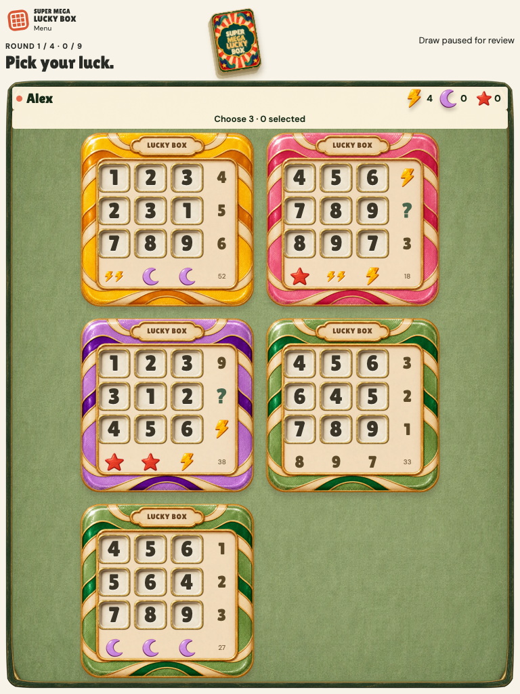
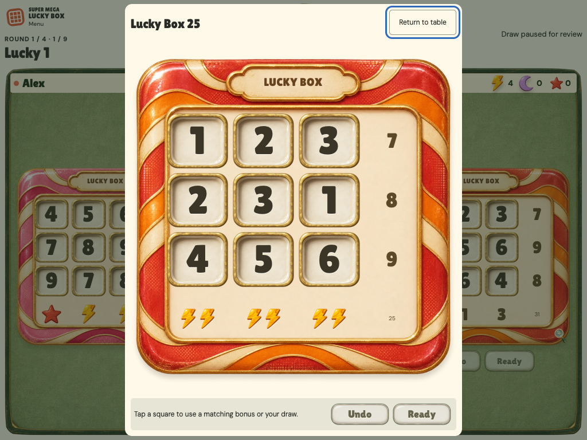
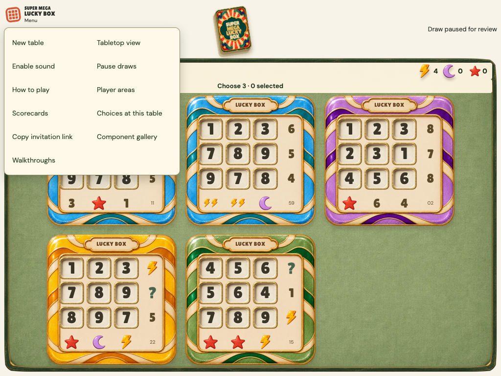

# iPad card layout review

Selection fits the complete offer into its measured surface: all five opening cards, or all three later offers. Opening offers use three columns in landscape and two in portrait. The existing tray remains visible as a compact, non-marking overview during later selection; touching a tray card opens the shared inspector. Selection does not use pages.

Tablets and medium-width laptop windows use a 104px status strip instead of the 200px side rail. Ordinary play retains 260px minimum cards for number marking, reserves the 44px contextual action dock, and caps unnecessarily large cards at 320px. Extra play cards may still use explicit pages. The layout responds to the actual card surface and the visual viewport, including Safari browser-bar height changes; pinch zoom does not shrink the game surface.

Ad hoc review used the production UI, Playwright 1.61.1 WebKit, and isolated Auth/Firestore emulators (`demo-supermega`, `ipad-review` scope). The later-round fixture was generated by replaying valid engine decisions, not by replacing the card renderer or supplying an alternate UI. No production data was used. This is review evidence, not screenshot baseline verification or an expanded gameplay e2e suite.

| Viewport | Opening offers | Card size | Document scroll |
| --- | --- | --- | --- |
| 768 × 1024 | All 5, two columns | 266px | None |
| 1024 × 768 | All 5, three columns | 276px | None |
| 1024 × 650 | All 5, three columns | 217px | None |
| 834 × 1100 | All 5, two columns | 292px | None |
| 1194 × 734 | All 5, three columns | 259px | None |
| 390 × 844 | All 5, two columns | 177px | None |
| 1180 × 820 | All 5, three columns | 302px | None |

All offer bounds were inside the viewport. Selecting two cards, rotating, and selecting the third preserved the selected identities and committed normally. Play was reviewed at 768×1024, 1024×768, and 1024×650; all three cards fitted and number targets measured at least 44px high. Later selection showed all three offers and all existing cards at those iPad sizes and 390×844. Touching an existing tray card opened the production inspector. Layout unit tests also cover six-card overview capacity and number-marking pagination.

Physical iPad Safari review remains useful; these captures use WebKit at representative viewport sizes rather than a physical device.

## Opening selection, landscape

## Opening selection, portrait

## Later selection, portrait

## Zoom and immediate input

The generated magnifier is shared by the game and gallery; no platform emoji controls remain. The live card grows from its exact originating instance, then the sheet and scrim fade in. Ready or Return fade the sheet out and shrink the card back into the tray. Reduced motion skips both effects. The enlarged card now uses the full inspector surface and scales its live numbers and rewards proportionally.

Ad hoc WebKit review at 1024×768 measured a 320px tray card, an intermediate flight size around 504px, and a 568px enlarged card. With Firestore traffic deliberately held, a well mark painted in one frame (about 14ms in this run), Undo applied before the first write completed, and both decisions remained persisted in order. Releasing the traffic committed each decision once. Ready reversed the zoom before its network acknowledgment. Reduced motion and the absence of emoji in visible interface text were checked. Independent WebKit profiles also committed simultaneous number choices successfully. These observations are not physical-iPad performance guarantees or screenshot baselines.

The outbox unit tests cover ordered rapid taps, dependent Undo, permanent rollback, retained retry IDs, restored queues and receipt deduplication, same-seat conflicts, acknowledgment/effect deduplication, confirmed-prefix reuse, ID collisions, and storage failures. The delay was acknowledgment-gated rendering, compounded by repeated history replay; no tap debounce or intentional well-mark timer was found.

## Logo menu instead of a header

The full-width game header is removed. A 44px logo/menu control sits at the upper left above the card area, and opens the global controls directly beneath it. The menu includes view switching, sound, help, player areas, scores, history, invitation copying and draw pacing. Ready and Undo remain with the active card. Opening the menu suspends the countdown; selecting Pause/Resume closes it. Escape and outside clicks dismiss it.

WebKit review checked the complete menu and all five offers at 768×1024, 1024×768, 1024×650, 390×844, 320×568, 844×390, 568×320, and 1920×1080. The menu uses three columns in short landscape windows so its controls remain inside the viewport. Sound, Escape dismissal, paged help, and draw pacing were exercised.

